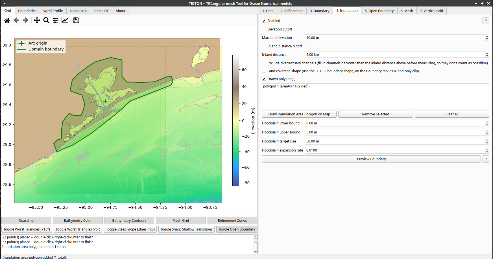

# TRITON

TRITON is a desktop GUI application for building unstructured triangular meshes for coastal and ocean circulation models. It helps you go from a coastline shapefile and bathymetry raster to a simulation-ready mesh: defining the mesh domain (rectangle/arc open boundaries), refining resolution along channels or over areas of interest, carving out inundation/flooding extents (by elevation, inland distance, or hand-drawn polygons), generating and auto-fixing the triangular mesh, setting up 2D or 3D (SZ) vertical grids, and exporting to multiple model formats (SCHISM `.gr3`, SMS `.2dm`, ADCIRC `.fort14`, Delft3D-FM UGRID `.nc`).

## Tutorial

A ~13-minute walkthrough covering the full workflow — loading data, drawing boundaries, refinement zones, inundation areas, mesh generation and quality fixing, interactive node editing, vertical grid setup, and saving to different model formats:

**[Watch on YouTube](https://www.youtube.com/watch?v=Eol78VuAh8E)**

## Status

This repository currently hosts project information only. Source code is not yet published here.

## Disclaimer

TRITON is an independent, personal project. I am not affiliated with, endorsed by, or sponsored by NOAA, the NOAA Office of Coast Survey (OCS), or any other government agency. Any resemblance to or use of terminology from NOAA/OCS tools is incidental and does not imply any official relationship, review, or endorsement.
